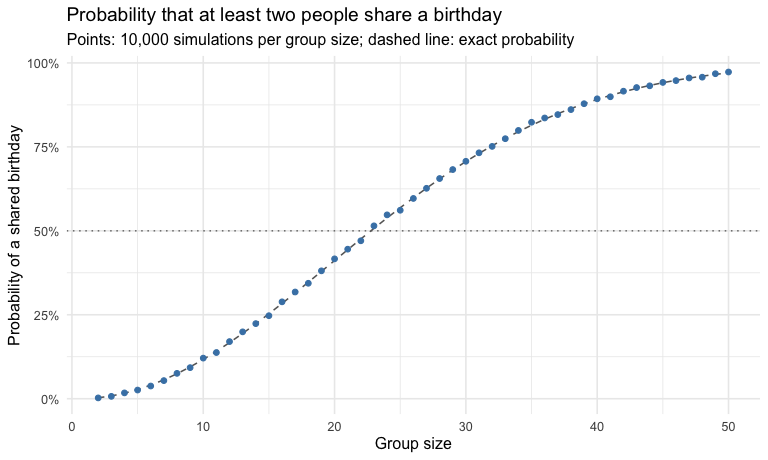
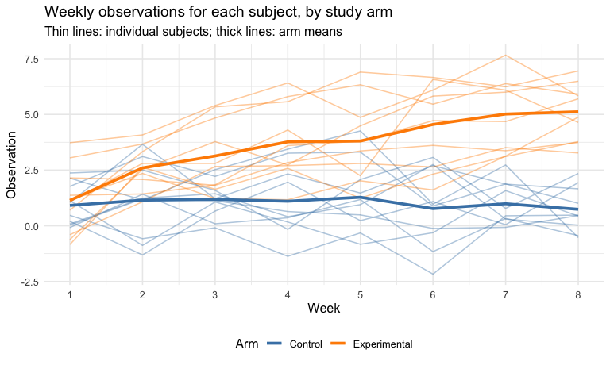

p8105_hw5_zz3593
================
Ziang Zhang
2026-11-18

``` r
library(tidyverse)
library(broom)

knitr::opts_chunk$set(
  fig.width = 8,
  fig.asp = .6,
  out.width = "90%"
)

theme_set(theme_minimal(base_size = 12) + theme(legend.position = "bottom"))

set.seed(8105)
```

# Problem 1

The function below draws a birthday for each of `n_people` people,
uniformly from 365 days with replacement, and returns `TRUE` if at least
two people share a birthday.

``` r
bday_sim = function(n_people) {
  birthdays = sample(1:365, size = n_people, replace = TRUE)

  any(duplicated(birthdays))
}
```

Next, I run the function 10,000 times for each group size from 2 to 50
and average the results to estimate the probability of a shared
birthday. For comparison, I also compute the exact probability,
$1 - \prod_{k = 0}^{n - 1} \frac{365 - k}{365}$.

``` r
bday_results =
  expand_grid(
    group_size = 2:50,
    iter = 1:10000
  ) |>
  mutate(shared = map_lgl(group_size, bday_sim)) |>
  group_by(group_size) |>
  summarize(prob_shared = mean(shared)) |>
  mutate(
    prob_exact = map_dbl(group_size, \(n) 1 - prod((365 - 0:(n - 1)) / 365))
  )

first_over_half =
  bday_results |>
  filter(prob_shared > 0.5) |>
  pull(group_size) |>
  min()
```

``` r
bday_results |>
  ggplot(aes(x = group_size, y = prob_shared)) +
  geom_hline(yintercept = 0.5, linetype = "dotted", color = "grey50") +
  geom_line(aes(y = prob_exact), linetype = "dashed", color = "grey40") +
  geom_point(color = "steelblue") +
  scale_y_continuous(labels = scales::percent) +
  labs(
    title = "Probability that at least two people share a birthday",
    subtitle = "Points: 10,000 simulations per group size; dashed line: exact probability",
    x = "Group size",
    y = "Probability of a shared birthday"
  )
```



The probability of a shared birthday rises quickly with group size and
follows an S-shaped curve. With 2 people it is only about 0.2%, but it
first exceeds 50% at a group size of 23, and by 50 people it reaches
about 97.3%. This is much faster than most people expect, because the
number of possible pairs grows quadratically with group size: 23 people
already form 253 pairs. The simulated estimates sit almost exactly on
the exact curve, so 10,000 runs per group size are enough to estimate
these probabilities well. In real life birthdays are not uniform across
the year, which only makes a shared birthday slightly more likely than
these results suggest.

# Problem 2

The longitudinal study data has one CSV file per participant, and each
file name gives the study arm (`con` or `exp`) and the subject ID. I
start with a dataframe of all file names from `list.files`, then use
`purrr::map` to read each subject’s data into a list column.

``` r
study_df =
  tibble(file_name = list.files("data", pattern = "\\.csv$")) |>
  mutate(
    data = map(file.path("data", file_name), \(path) read_csv(path, show_col_types = FALSE))
  )
```

To tidy the result, I pull the arm and subject ID out of the file name,
unnest the subject data, and pivot the eight weekly columns into one row
per subject per week. Subject IDs restart at 01 in each arm, so I also
make a `subject` variable that is unique across arms.

``` r
study_tidy =
  study_df |>
  mutate(file_name = str_remove(file_name, "\\.csv$")) |>
  separate(file_name, into = c("arm", "subject_id"), sep = "_", remove = FALSE) |>
  rename(subject = file_name) |>
  unnest(data) |>
  pivot_longer(
    week_1:week_8,
    names_to = "week",
    names_prefix = "week_",
    names_transform = as.integer,
    values_to = "observation"
  ) |>
  mutate(
    arm = factor(arm, levels = c("con", "exp"), labels = c("Control", "Experimental"))
  ) |>
  select(subject, arm, subject_id, week, observation)

study_tidy
```

    ## # A tibble: 160 × 5
    ##    subject arm     subject_id  week observation
    ##    <chr>   <fct>   <chr>      <int>       <dbl>
    ##  1 con_01  Control 01             1        0.2 
    ##  2 con_01  Control 01             2       -1.31
    ##  3 con_01  Control 01             3        0.66
    ##  4 con_01  Control 01             4        1.96
    ##  5 con_01  Control 01             5        0.23
    ##  6 con_01  Control 01             6        1.09
    ##  7 con_01  Control 01             7        0.05
    ##  8 con_01  Control 01             8        1.94
    ##  9 con_02  Control 02             1        1.13
    ## 10 con_02  Control 02             2       -0.88
    ## # ℹ 150 more rows

The tidy dataset has 160 rows, one for each of 20 subjects (10 per arm)
in each of 8 weeks.

``` r
arm_means =
  study_tidy |>
  group_by(arm, week) |>
  summarize(mean_obs = mean(observation), .groups = "drop")

study_tidy |>
  ggplot(aes(x = week, y = observation, color = arm)) +
  geom_line(aes(group = subject), alpha = 0.4) +
  geom_line(data = arm_means, aes(y = mean_obs), linewidth = 1.3) +
  scale_x_continuous(breaks = 1:8) +
  scale_color_manual(values = c("Control" = "steelblue", "Experimental" = "darkorange")) +
  labs(
    title = "Weekly observations for each subject, by study arm",
    subtitle = "Thin lines: individual subjects; thick lines: arm means",
    x = "Week",
    y = "Observation",
    color = "Arm"
  )
```



``` r
arm_means |>
  filter(week %in% c(1, 8)) |>
  pivot_wider(names_from = week, names_prefix = "week_", values_from = mean_obs) |>
  mutate(change = week_8 - week_1) |>
  knitr::kable(
    digits = 2,
    col.names = c("Arm", "Mean at week 1", "Mean at week 8", "Change")
  )
```

| Arm          | Mean at week 1 | Mean at week 8 | Change |
|:-------------|---------------:|---------------:|-------:|
| Control      |           0.92 |           0.74 |  -0.18 |
| Experimental |           1.14 |           5.12 |   3.98 |

``` r
arm_week1 = arm_means |> filter(week == 1) |> pull(mean_obs, name = arm)
arm_week8 = arm_means |> filter(week == 8) |> pull(mean_obs, name = arm)

week8_range =
  study_tidy |>
  filter(week == 8) |>
  group_by(arm) |>
  summarize(min_obs = min(observation), max_obs = max(observation))

exp_week8_min = week8_range |> filter(arm == "Experimental") |> pull(min_obs)
con_week8_max = week8_range |> filter(arm == "Control") |> pull(max_obs)
```

The two arms start at similar values: at week 1 the mean observation is
0.92 in the control arm and 1.14 in the experimental arm, and the
individual trajectories overlap a lot. Over the eight weeks, subjects in
the experimental arm show a steady upward trend, while control subjects
fluctuate around a roughly constant level with no clear trend. By week 8
the experimental mean has risen to 5.12, compared with 0.74 for the
control arm. At week 8 the arms no longer overlap at all: the lowest
experimental subject (3.27) is above the highest control subject (2.35).
Within each arm there is a lot of week-to-week variability for
individual subjects, but the difference between the arms grows over
time, which suggests the experimental condition increases the outcome.
